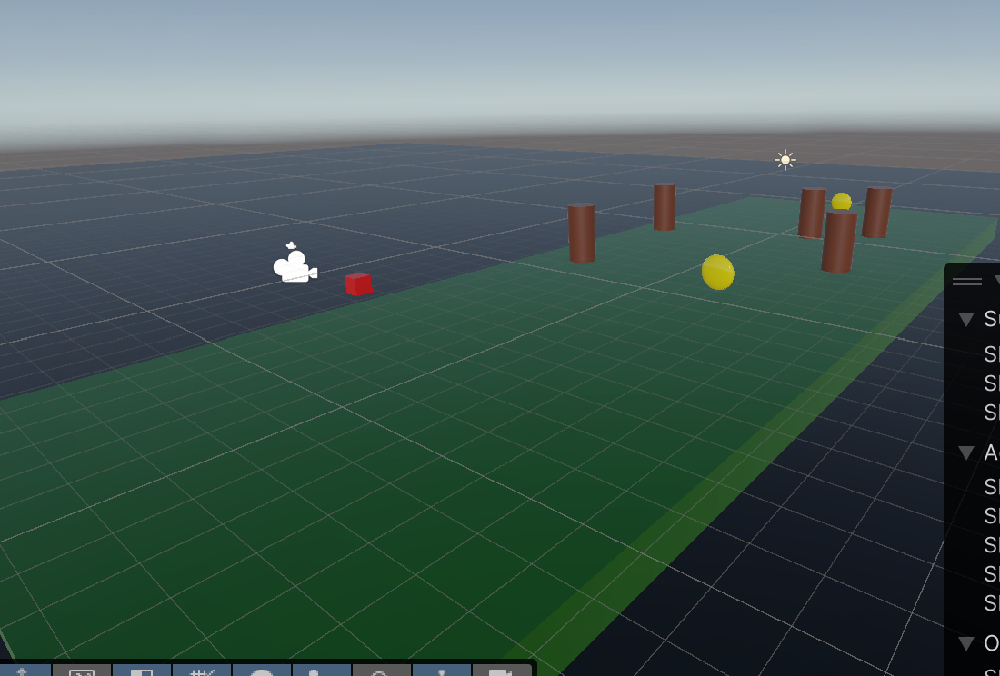
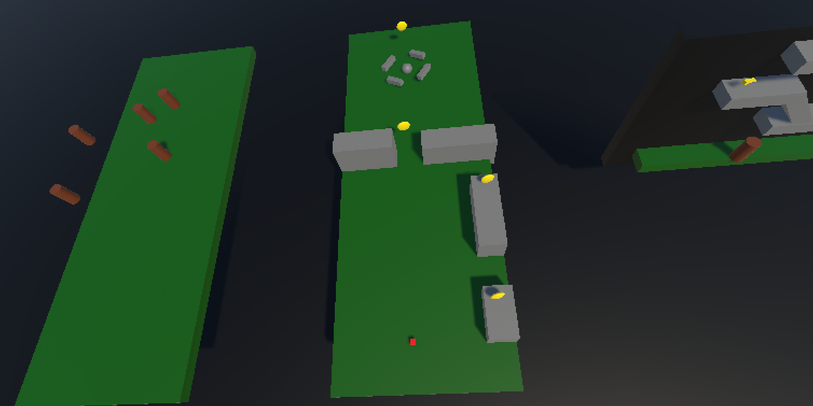
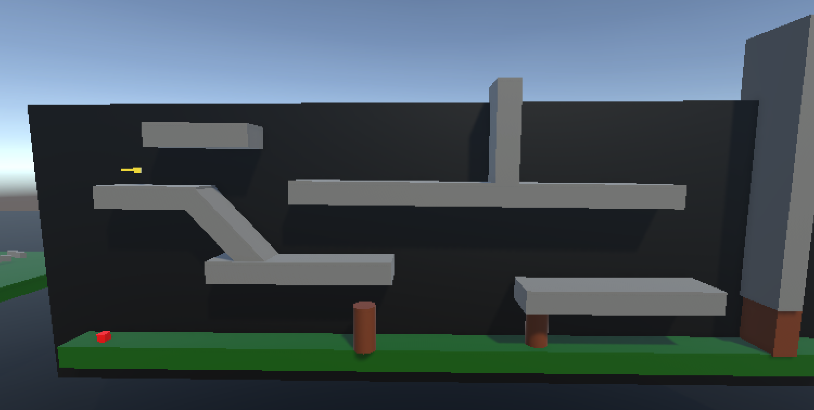

# Mijn eerste unity project.

Voor mijn eerste unity project heb ik een mini level gemaakt. Ik had vanaf het begin al voor genomen om kamers te maken. In de eerste kamer heb je 2 coins die je moet verzamelen terwijl je de bruine torens genaamd Goonba's ™️moet vermijden. 

In het tweede level hebben we constructies met coins erop. De speler moet springen om te platformen. 

Als alles weer is opgepakt wordt de speler in de derde kamer gezet. Dit is je typische 2D platformer waarbij de speler de sleutel moet pakken om door de deur te mogen lopen.

# Belangrijk.
Er zijn veel scripts bij dit project die ik niet gebruik. De volgende scripts worden wel gebruikt.

Minigame/Cameraswap.cs 
LesKim/Goomba.cs 
LesKim/Rotation.cs 
LesKim/Movement.cs 
LesKim/CollectItem.cs 

# Verdere opmerkingen
Oorspronkelijk wilde ik een soort Plants vs Zombies maken. Echter had ik het gevoel dat ik niet heel veel tijd zou hebben en de code bleek ingewikkelder dan gedacht. Ik had al een goede opzet voor het minilevel dus heb ik dingen getweaked en het ingeleverd.

Verder heb ik gekozen om te wisselen tussen camera's. Eerst wilde ik een mouse systeem gebruiken zodat de speler kon rondkijken, maar (waarschijnlijk) omdat ik de camera heb vastgemaakt aan de speler deed de camera beweging heel erg raar.

Om mijn concept van meerdere camera's nog steeds te laten werken, heb ik besloten om te wisselen tussen al bestaande camera's. Dit op zichzelf had wel een uitdaging, met name het meegeven van de 'coins collected' waarde naar een andere script want het idee moet juist zijn om scripts niet te groot te maken. Het duurde me eventjes maar dat was mij gelukt en dus dat samen met een switch systeem, maakt een best redelijke script.

De reden overigens om een switch systeem in plaats van een if systeem is om te besparen op data/lines die ik vervolgens hier in deze readme weer kan gebruiken voor overbodige, verschrikkelijk lange novella's die dienen als mijn reflectie op deze opdracht.